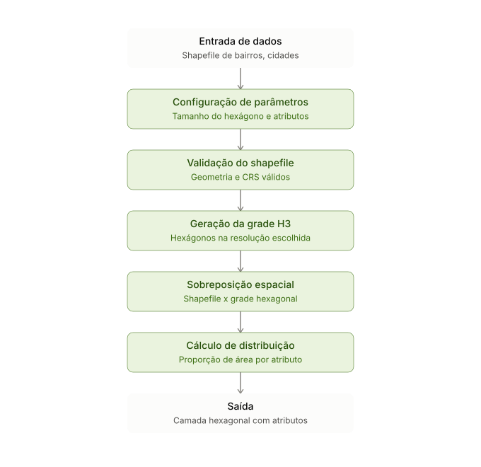

<header id="header">
  
</header>

# **Estruturação do projeto: Automatização da Agregação Hexagonal H3 para QGIS**

## **1. Visão geral**

O objetivo do projeto é transformar camadas vetoriais de polígonos (bairros, distritos, municípios, setores censitários, qualquer granularidade administrativa) em uma grade hexagonal padronizada, baseada no sistema H3 da Uber, redistribuindo os atributos numéricos originais para os hexágonos gerados.

Isso resolve um problema comum em análise espacial: comparar ou combinar dados de fontes com malhas territoriais diferentes e incompatíveis entre si. Ao levar tudo para uma grade hexagonal comum, com resolução configurável, os dados passam a ser diretamente comparáveis, agregáveis e cruzáveis entre diferentes fontes, escalas e períodos.

A estratégia de desenvolvimento será incremental: 
1. Primeiro, um **script em Python**, validado com dados reais e testável fora do QGIS;
2. Depois, a **migração para um plugin PyQGIS**, reaproveitando a lógica já validada e apenas envolvendo-a em interface e integração com o ambiente do QGIS, adaptado aos sistemas operacionais suportados (Windows, Linux, macOS).

---

## **2. Arquitetura conceitual**

O núcleo funcional do projeto pode ser dividido em três blocos, independentes da camada de interface:

1. **Ingestão e validação**: leitura do shapefile de entrada, checagem de geometria válida e de sistema de referência de coordenadas (CRS).
2. **Geração e cruzamento com a grade H3**: criação dos hexágonos cobrindo a extensão da camada de entrada, na resolução escolhida, seguida da sobreposição espacial (overlay) entre os polígonos originais e os hexágonos.
3. **Redistribuição de atributos**: cálculo dos valores de cada atributo por hexágono, respeitando a natureza de cada variável (extensiva ou intensiva).

Esses três blocos formam o core do sistema. A interface, seja linha de comando no script, seja um painel do QGIS no plugin, será uma camada por cima desse motor.

---

## **3. Fase 1 | Script Python**

### **3.1 Justificativa**

Construir primeiro fora do QGIS permite:

- Iterar rapidamente sem o _overhead_ de recarregar plugins a cada mudança.
- Escrever testes automatizados de forma isolada (`pytest`) sem depender do ambiente PyQGIS.
- Depurar com ferramentas Python padrão (_debugger_ , _profiler_) sem as limitações do console do QGIS.
- Validar a lógica de cálculo com dados reais antes de investir tempo em interface gráfica.

### **3.2 Dependências principais**

- `geopandas` - leitura de shapefile, operações geométricas e overlay.
- `h3` (h3-py) - geração de índices e geometrias hexagonais.
- `shapely` - manipulação geométrica de baixo nível (já vem como dependência do geopandas).
- `pandas` / `numpy` - agregações e cálculos numéricos.
- `pyproj` - reprojeções de CRS quando necessário.
- `click` ou `argparse` - interface de linha de comando.
- `pytest` - testes automatizados.

### **3.3 Estrutura de diretórios sugerida**

```
h3-indexing/
├── src/
│   └── h3-indexing/
│       ├── __init__.py
│       ├── io.py              # leitura/escrita de shapefile, geopackage
│       ├── validation.py      # validação de geometria e CRS
│       ├── h3_grid.py         # geração da grade hexagonal H3
│       ├── overlay.py         # sobreposição espacial
│       ├── distribution.py    # cálculo de distribuição (extensivo/intensivo)
│       └── cli.py             # interface de linha de comando
├── tests/
│   ├── test_validation.py
│   ├── test_h3_grid.py
│   ├── test_overlay.py
│   └── test_distribution.py
├── data/
│   └── exemplos/               # shapefiles de exemplo para testes manuais
├── pyproject.toml
└── README.md
```

Essa separação em módulos pequenos e testáveis será "encaixado" no plugin sem reescrita, o plugin vai importar `h3-indexing` como uma biblioteca interna.

### **3.4 Fluxo de execução do script**

1. Carregar shapefile via `geopandas.read_file()`.
2. Validar geometria (`is_valid`, correção com `buffer(0)` se necessário) e CRS (reprojetar para um CRS geográfico compatível com H3).
3. Determinar a extensão (bounding box) da camada e gerar os hexágonos H3 que cobrem essa área, na resolução escolhida pelo usuário.
4. Converter os hexágonos H3 em geometrias (`h3.cell_to_boundary`) e montar um `GeoDataFrame`.
5. Executar `overlay` entre a camada original e a grade hexagonal (interseção).
6. Para cada atributo configurado, aplicar a fórmula correspondente ao seu tipo:
   - **Extensivo** (contagens, totais - população, domicílios, renda total): soma ponderada pela proporção de área de interseção em relação à área do polígono original.
   - **Intensivo** (médias, taxas, densidades - renda média, densidade populacional): média ponderada pela área de interseção.
7. Agregar os resultados por hexágono e exportar (Shapefile, GeoPackage ou GeoJSON).

A seguir, uma representação gráfica desse fluxo:



### **3.5 Interface de linha de comando (proposta inicial)**

```bash
hex-attr-distribute \
  --input bairros.shp \
  --output resultado.gpkg \
  --resolution 8 \
  --attr populacao:extensivo \
  --attr renda_media:intensivo
```

Essa CLI é, na prática, um "esboço" da futura interface gráfica do plugin: cada flag vira um campo de formulário, e a lógica por trás não precisa ser reescrita.

---

## **4. Fase 2 | Migração para plugin QGIS**

### **4.1 Estratégia de migração**

A migração não irá reescrever a lógica de negócio, irá apenas empacotar o módulo `h3-indexing` já testado como dependência do plugin e construir, por cima dele, a integração com o QGIS. Isso reduz o risco de regressões introduzidas durante a criação da interface.

Duas abordagens de interface podem ser usadas possíveis dentro do PyQGIS:

- **Algoritmo do Processing Framework** - será feita como primeira entrega. Aparece na Toolbox de Processamento, pode ser encadeado com outros algoritmos, roda em modo batch e ganha automaticamente uma interface de parâmetros gerada pelo próprio QGIS.
- **Dock widget customizado** - uma segunda etapa opcional, será feita se for necessário um fluxo guiado, com pré-visualização interativa dos hexágonos antes de confirmar o processamento.

### **4.2 Estrutura de diretórios do plugin**

```
hex_attr_qgis_plugin/
├── __init__.py                 # ponto de entrada, classFactory()
├── metadata.txt                # nome, versão, descrição, autor
├── plugin_main.py              # classe principal do plugin (menus, ícones)
├── processing_provider.py      # registro do provider no Processing Framework
├── algorithms/
│   └── hex_distribute_algorithm.py   # QgsProcessingAlgorithm
├── h3-indexing/                # módulo reaproveitado da fase 1 (vendored ou dependência)
├── resources/
│   ├── icon.png
│   └── resources.qrc
├── i18n/                       # traduções, se necessário
└── help/
    └── index.rst
```

### **4.3 Parâmetros expostos no plugin**

| Parâmetro | Tipo QGIS | Equivalente na CLI da fase 1 |
|---|---|---|
| Camada de entrada | `QgsProcessingParameterFeatureSource` | `--input` |
| Resolução H3 (0–15) | `QgsProcessingParameterNumber` | `--resolution` |
| Atributos a distribuir | `QgsProcessingParameterField` (múltiplo) | `--attr` |
| Tipo de cada atributo (extensivo/intensivo) | `QgsProcessingParameterEnum` por atributo | sufixo em `--attr` |
| Camada de saída | `QgsProcessingParameterFeatureSink` | `--output` |

---

## **5. Cálculo de distribuição de atributos**

Para cada hexágono, calcula-se primeiro a **área de interseção** entre ele e cada polígono original que o sobrepõe. A partir daí, a fórmula usada depende da natureza do atributo:

- **Atributos extensivos** (grandezas que fazem sentido somar: população, número de domicílios, receita total): o valor do hexágono é a soma, sobre todos os polígonos que o interceptam, do valor original multiplicado pela proporção da área do polígono que caiu dentro do hexágono.
- **Atributos intensivos** (grandezas que não fazem sentido somar, apenas mediar: renda média, densidade populacional, taxas percentuais): o valor do hexágono é a média dos valores originais, ponderada pela área de interseção de cada polígono.

Essa distinção deve ser um parâmetro explícito por atributo, nunca inferida automaticamente, porque a mesma coluna numérica pode representar uma coisa ou outra dependendo do contexto dos dados, e aplicar a fórmula errada gera resultados plausíveis mas metodologicamente incorretos.

A seguir, uma representação esquemática do cálculo:



---

## 6. **Roadmap de evolução**

1. **v0.1 — script funcional**: pipeline completo rodando via CLI, com um shapefile de exemplo, sem otimizações.
2. **v0.2 — testes e validação**: cobertura de testes para os módulos de validação, geração de grade e distribuição; validação manual comparando totais antes/depois (conservação de valores extensivos).
3. **v0.3 — empacotamento como biblioteca**: `h3-indexing` publicável internamente (via `pip install -e .` ou pacote privado), pronta para ser importada por qualquer front-end, incluindo o plugin.
4. **v1.0 — plugin Processing Framework**: algoritmo funcional na Toolbox do QGIS, reaproveitando a biblioteca da fase 1.
5. **v1.1 — refinamentos de UX**: validações de entrada mais amigáveis, mensagens de erro claras, pré-visualização opcional da grade antes do processamento completo.
6. **v1.2 (opcional) — dock widget interativo**: fluxo guiado com prévia visual dos hexágonos e ajuste de resolução em tempo real.

---

## **7. Considerações finais**

O planejamento detalhado nesse documento é pautada na ideia de que a lógica de negócio isolada do código de interface, seja CLI, seja PyQGIS, é a decisão arquitetural mais importante deste projeto. Ela é o que permite testar rápido na fase de script e depois "plugar" essa mesma lógica no QGIS sem reescrever a parte que já foi validada.